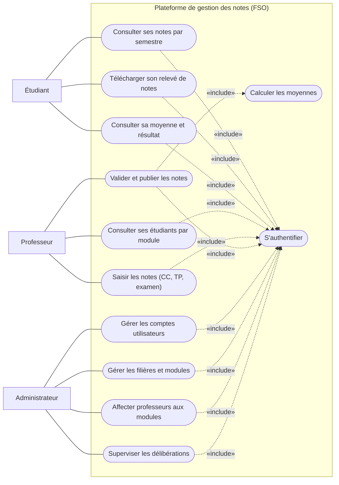
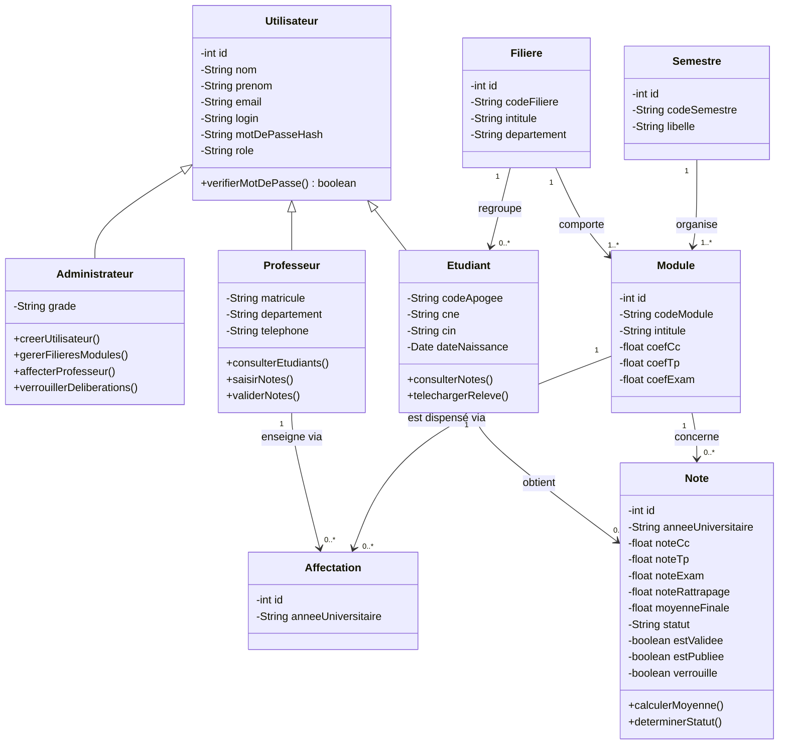

# Gestion des notes d'une faculté (FSO)

Plateforme web de gestion des notes : saisie des notes par les professeurs, calcul automatique des moyennes, publication et consultation des résultats par les étudiants, administration des filières, modules et comptes.

## Équipe

| Membre | Rôle dans le projet |
|---|---|
| Dounia Zirari | À compléter |
| Oumayma Bouakline | À compléter |

Encadrant : M.Mohcine boukssim

## Technologies

- **Python** : logique de l'application
- **MySQL** : base de données
- **HTML** et **CSS** : interface
- **Git / GitHub** : suivi du travail

## Fonctionnalités

- **Étudiant** : consulter ses notes par semestre, sa moyenne et son résultat (V / RAT / NV), télécharger son relevé de notes.
- **Professeur** : consulter la liste de ses étudiants par module, saisir les notes (CC, TP, examen), valider et publier les notes. Les moyennes sont calculées automatiquement.
- **Administrateur** : gérer les comptes, les filières et les modules, affecter les professeurs aux modules, superviser et verrouiller les délibérations.
- **Tous les utilisateurs** doivent s'authentifier avant d'accéder à une fonctionnalité.

## Diagramme de cas d'utilisation





## Diagramme de classes




## Structure du projet

```
gestion-notes-faculte/
├── app.py                
├── database/
│   └── schema.sql        
├── templates/            
├── static/
│   └── css/style.css      
├── .gitignore
└── README.md
```


## Répartition des tâches

| Tâche | Responsable | État |
|---|---|---|
| Diagrammes UML | À compléter | Terminé |
| Base de données MySQL | À compléter | En cours |
| Authentification | À compléter | À faire |
| Interface professeur | À compléter | À faire |
| Interface étudiant | À compléter | À faire |
| Interface administrateur | À compléter | À faire |
